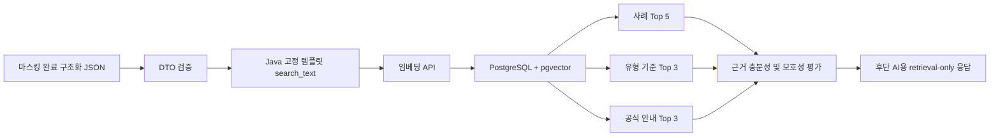

# 포트폴리오에 설명할 수 있는 구현 범위

2026-10-28 추가: [실제 임베딩 소규모 후보 실험](public-pool-experiment.md)을 완료했다.
다음처럼 범위를 명시해 설명할 수 있다.

> 공개 민원 사례 500건을 dev 100건/test 400건으로 나누어 실제 임베딩을 생성하고,
> 공식 안내 후보 6개에서 기본 검색과 재정렬을 비교했습니다. AI 중심 평가 라벨 기준으로
> 메타데이터 재정렬의 Recall@3은 91.24%에서 95.62%, MRR은 0.6934에서 0.8187로
> 높아졌습니다. 후보 수와 라벨 품질의 한계를 명시하고, 이 결과만으로 운영 전략을 변경하지 않았습니다.

이 문단의 Recall/MRR은 평가용 400건 중 관련 문서가 있는 137건 기준이다.
대규모 corpus·독립 사람 정답·운영 DB 지연을 검증한 결과로 확장하지 않는다.

## 프로젝트 소개 문장

> 경찰 민원 안내 서비스의 RAG 검색 백엔드를 구현했습니다. 개인정보가 제거된 구조화
> 민원을 고정 템플릿의 검색문으로 변환하고, PostgreSQL·pgvector에서 유사 사례,
> 유형 기준, 공식 안내를 각각 검색합니다. 검색 점수만으로 충분한 근거라고 단정하지
> 않도록 근거 부족과 모호성을 평가하고, 후단 AI에 검색 결과와 위험 신호를 전달합니다.

현재 범위에 맞는 제목은 **「경찰 민원 안내를 위한 RAG 검색·평가 파이프라인」**이다.
최종 답변 생성 LLM이나 최종 민원 분류까지 연결한 전체 RAG 서비스 완성을 뜻하지 않는다.

## 구현한 흐름

앞단의 개인정보 마스킹 모델, STT, 최종 안내 생성은 이 저장소의 구현 범위 밖이다.
벡터 모듈은 위험 신호를 보존하지만 최종 긴급 경로를 정하지 않는다.

## 설명할 만한 기술적 판단

| 문제 | 구현 및 판단 | 근거 |
|---|---|---|
| 자유 요약으로 검색 입력이 달라짐 | Java 고정 템플릿과 버전 관리 | `SearchTextBuilder`, `application.properties` |
| 서로 다른 종류의 근거가 단일 순위에 섞임 | 사례·유형·안내를 독립 채널로 검색 | `RetrievalSearchService` |
| Top-K가 반환돼도 근거가 약할 수 있음 | 충분성·모호성 평가, 위험 신호 별도 전달 | `RetrievalEvidenceEvaluator` |
| 재정렬 순위와 코사인 순위가 다름 | 근거 평가에서는 원래 코사인 점수를 유지 | `CandidateRanker`, 근거 평가 테스트 |
| 단일 순위 지표로 개선을 과장할 수 있음 | Recall·MRR·고정 K Precision과 모호성 검출을 함께 비교 | [실험 기록](retrieval-stress-experiment.md) |
| 실험을 다시 돌릴 때 조건이 바뀜 | 저장 벡터 재사용, 입력 해시, 고정 corpus 비교 | `RetrievalReplayExperiment` |
| AI 판단과 사람 판단이 섞임 | 출처·모델·버전·이전 판단을 보존한 qrels | [AI 관련성 판단](ai-relevance.md) |

## 자소서 문단 예시

> 경찰 민원 안내 서비스에서 후단 AI가 참고할 근거를 검색하는 백엔드 모듈을 구현했습니다.
> 구조화된 민원을 일정한 형식으로 임베딩하고, 유사 사례·유형 기준·공식 안내를 나누어
> 검색하도록 설계했습니다. 재정렬 전략을 비교하는 과정에서 상위 1개 결과의 적중률이
> 높아져도 상충하는 근거가 탈락해 모호성 검출이 악화될 수 있음을 확인했습니다. 이를
> 바탕으로 단일 지표의 상승만으로 전략을 채택하지 않고, 근거 회수율과 불확실성 처리를
> 함께 검증하는 평가 체계를 구성했습니다.

이 문단의 실험 관찰은 **합성 순위 시나리오 실험**에 대한 것이다. 실제 민원 임베딩의
검색 정확도 개선으로 바꿔 쓰지 않는다. 팀 프로젝트의 개인 기여는 실제 맡은 범위로
조정하고, AI 개발 도구를 활용한 부분과 본인이 검증한 내용을 설명할 수 있도록 준비한다.

## 수치를 사용할 때의 구분

- Java 테스트 615개 통과: 2026-10-26 실행 기록. 실제 사용자 민원 615건의 정확도를 뜻하지 않는다.
- 합성 순위 시나리오 500개: dev 100/test 400. 실제 민원 임베딩 실험과 구분한다.
- 실제 공개 사례 500건: 기관이 정리한 민원 발췌이며, 경찰 107건과 타 분야 393건이다.
  최신 민원을 대표하는 무작위 표본이나 시민 제출 원문 500건으로 표현하지 않는다.
- AI 관련성 라벨: 사람이 독립적으로 검증한 정답이 아니다. 이 라벨로 산출한 지표는
  AI 라벨 기준 비교이고 실제 서비스의 객관적 정확도 인증이 아니다.

현재 쓰지 않을 표현: 「전체 RAG 서비스 상용화 완료」, 「민원 자동 분류 정확도 검증」,
「실제 민원 500건에서 검색 성능 향상 입증」. 해당 결과가 실제 확보된 뒤 범위를 명시한다.

## 면접에서 설명할 질문

1. `search_text`를 LLM 자유 생성 대신 고정 템플릿으로 만든 이유는 무엇인가?
2. 세 채널을 나누고 각각 Top-K를 지정한 이유는 무엇인가?
3. 코사인 점수, 재정렬 점수, 근거 충분성은 어떻게 다른가?
4. CODE_RRF는 어떤 상황에서 좋아지고 어떤 상황에서 악화됐는가?
5. 데이터 분리·중복·정답 유출·AI 라벨 편향을 어떻게 관리했는가?
6. 실제 서비스에 연결하려면 어떤 검증과 후단 구현이 남았는가?

구현 파일·커밋 목록은 [작업 기록](work-log-2026-10-26.md), 검색 설계와 측정 한계는
[검색 최적화 실험](retrieval-optimization.md)을 따른다.
